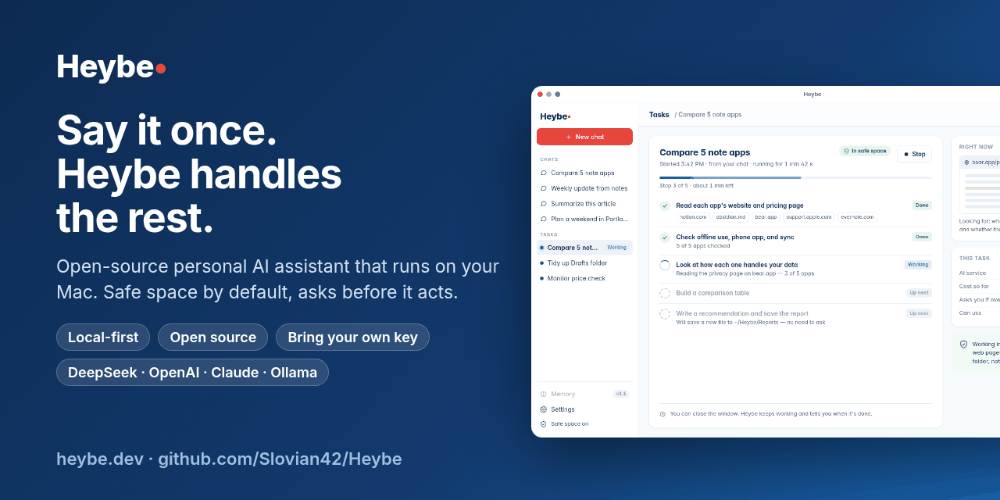
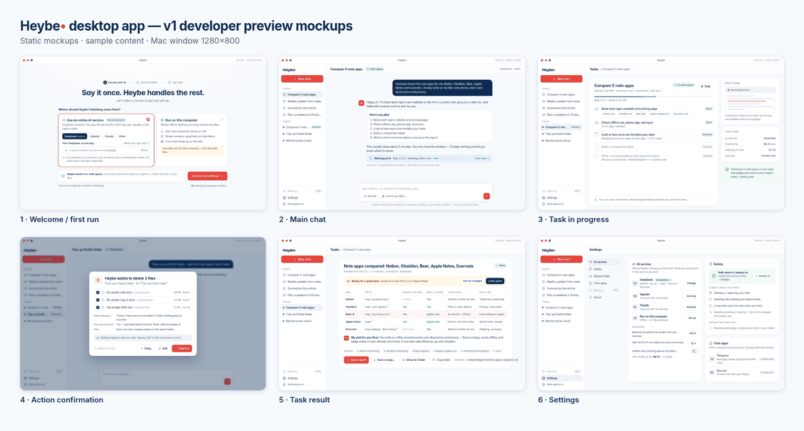
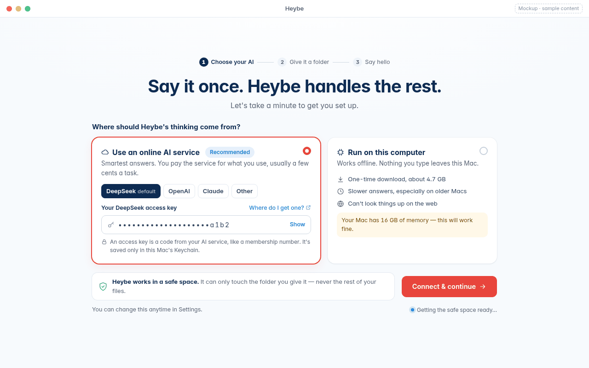
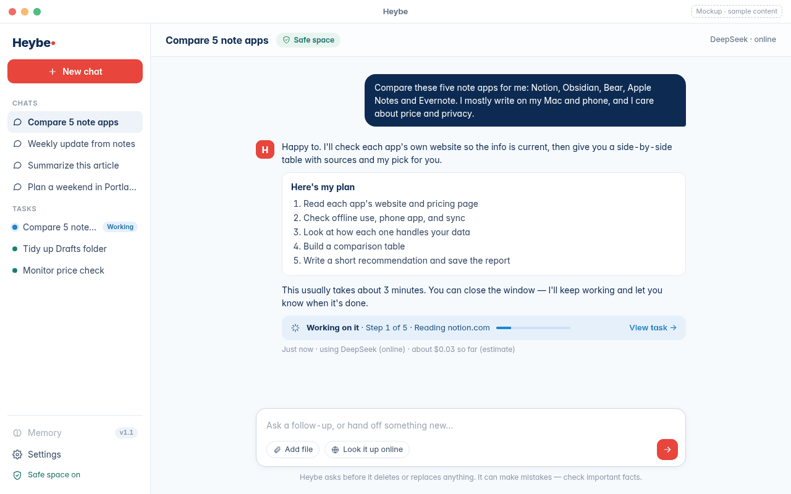
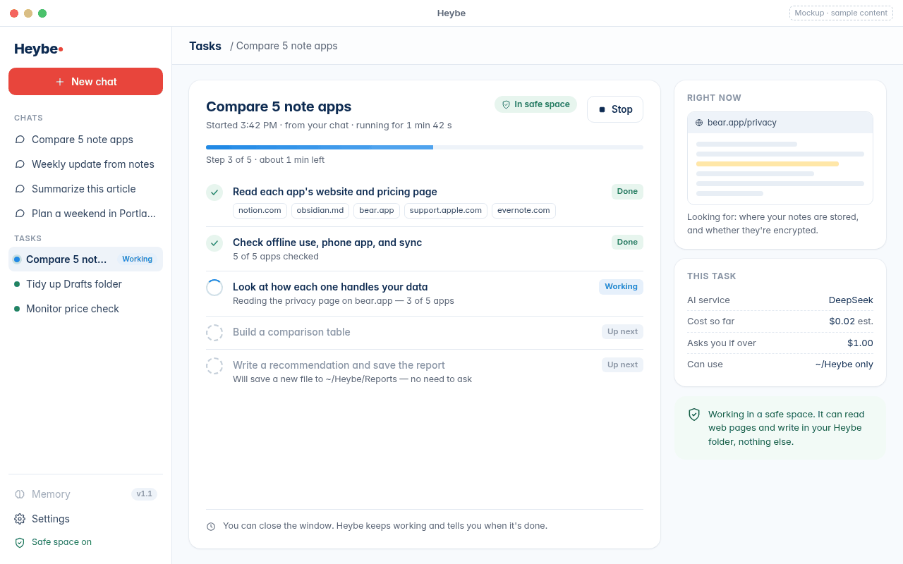
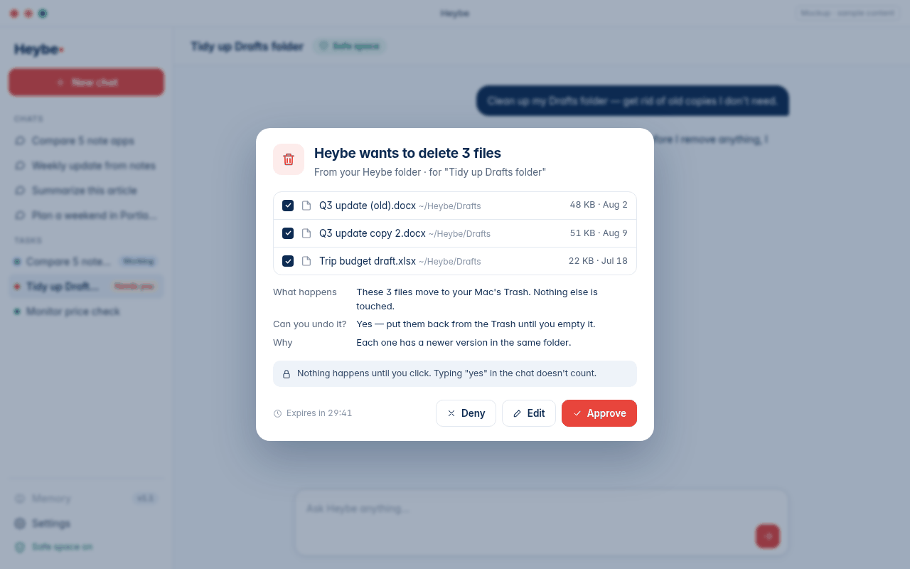
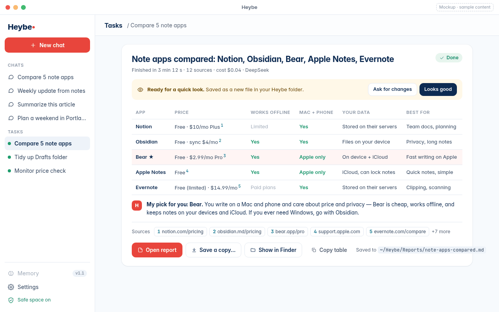
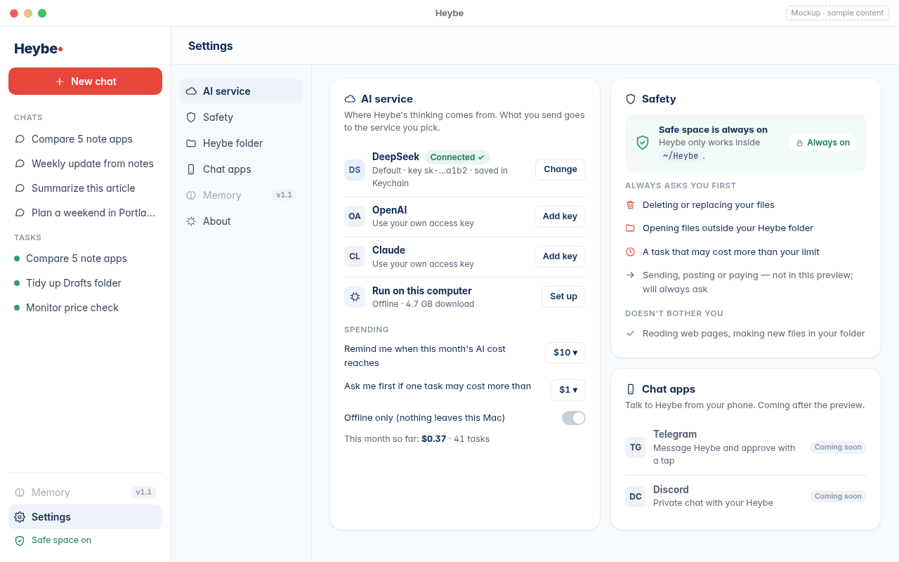

<!-- Heybe：開源的 Mac 本機 AI 助理 / 本機 AI 代理（AI Agent），可自帶 API Key -->
<p align="center">
  <a href="https://heybe.dev"></a>
</p>

<h1 align="center">Heybe：開源的 Mac 本機個人 AI 助理</h1>

<p align="center"><b>說一句，剩下的交給它。</b><br>
裝在你自己電腦上的 AI 代理（AI Agent）：在沙箱裡工作，做敏感操作前先問你。<br>
預設使用 DeepSeek，也可以填自己的 OpenAI 或 Claude API Key。</p>

<p align="center">
  <a href="LICENSE"></a>
  <a href="https://github.com/Slovian42/Heybe/actions/workflows/ci.yml"></a>
  
  
  <a href="CONTRIBUTING.md"></a>
  <a href="https://heybe.dev"></a>
</p>

<p align="center">
  <a href="README.md">English</a> ·
  <a href="README.zh-CN.md">简体中文</a> ·
  <b>繁體中文</b> ·
  <a href="README.ja.md">日本語</a> ·
  <a href="README.ko.md">한국어</a> ·
  <a href="README.es.md">Español</a> ·
  <a href="README.pt-BR.md">Português (Brasil)</a> ·
  <a href="README.de.md">Deutsch</a> ·
  <a href="README.fr.md">Français</a>
</p>

> [!IMPORTANT]
> **目前狀態：開發者預覽版開發中，還沒有可下載的安裝包。** 下面的截圖是設計稿，內容為範例資料，不代表最終介面。
> 想第一時間試用，請到 **[heybe.dev](https://heybe.dev)** 留下 Email，或先體驗[可點選的互動原型](https://heybe.dev/demo)。

## Heybe 是什麼？

Heybe 是一個**跑在你自己電腦上的私人 AI 助理**。你像跟朋友說話一樣交代一件事，它會拆成步驟、上網查資料、寫好報告或草稿，並把結果存成檔案放在你的 Mac 上。關掉視窗它也會接著做。

它面向從沒用過 「AI Agent」 的普通使用者，也面向想要一個**可自託管、可審查、可修改**的 AI 助理的一人公司和開發者：

- **本機執行**：檔案、任務和歷史記錄都留在你的電腦上。
- **安全空間**：所有操作預設在隔離沙箱裡執行，碰不到你的個人檔案。
- **先問再做**：刪檔案、寫到它的資料夾之外、超出預算，都要你親手點一下確認；在聊天裡打「好」不算數。
- **模型自己選**：預設 DeepSeek；可以自帶 OpenAI 或 Anthropic Claude 的 API Key；也可以用 Ollama 跑本機模型離線聊天。
- **開源**：社群版採用 Apache-2.0，建置和執行都不需要註冊我們的帳號。

## 介面預覽（設計稿）

> 以下為 v1 設計稿，內容均為範例，實際產品可能不同。

<p align="center">
  
</p>

| | |
|---|---|
| <br>**1. 首次啟動**：選 AI 從哪來（DeepSeek、自己的 Key 或本機模型）。 | <br>**2. 對話**：說一句，它先列計劃；關掉視窗也會繼續。 |
| <br>**3. 任務進行中**：即時步驟、安全空間標識、停止按鈕、已花費用。 | <br>**4. 操作確認**：敏感操作等你點：拒絕、修改或同意。 |
| <br>**5. 任務結果**：帶來源的成品報告，存在你的 Heybe 資料夾。 | <br>**6. 設定**：AI 服務和金鑰、安全規則、聊天軟體（即將推出）。 |

## Heybe 能幫你做什麼？

| 你說 | Heybe 做 |
|---|---|
| “幫我比較這五款筆記軟體。” | 逐個看官網，做出帶來源的對比表，並給出推薦。 |
| “把這份會議記錄整理成周報。” | 提煉決定、待辦和負責人，生成可編輯的草稿。 |
| “總結這篇文章和它引用的三篇。” | 讀完網頁，寫一份附連結的簡報。 |
| “幫我清理草稿資料夾。” | 找出舊副本，移到廢紙簍前先問你。 |
| “查一下週末去波特蘭的機票和酒店。” | 把選項整理到一頁，方便你挑。 |
| “把這周的網站資料做個小結。”（一人公司） | 一份簡短回顧，加上下週的幾條建議。 |

更多場景見 [docs/use-cases.md](docs/use-cases.md)。首個預覽版之後計劃加入：定時早報、降價提醒，以及在 **Telegram** 等聊天軟體裡直接和 Heybe 對話。

## 功能與進度

| 功能 | 狀態 |
|---|---|
| macOS 桌面應用（Tauri + React），優先支援 Apple Silicon | 開發中 |
| 流式對話：DeepSeek（預設）、OpenAI、Claude（自帶 API Key） | 開發中 |
| 透過 Ollama 使用本機模型（僅聊天，可離線） | 開發中 |
| 直接讀取網頁的聯網搜尋，標註來源 | 開發中 |
| 關窗不丟的長任務（本機任務管家，SQLite） | 骨架已合併 |
| 預設開啟沙箱：每個會話一臺微型虛擬機器（Apple Silicon 用 BoxLite，備選 Lima） | 概念驗證中 |
| 敏感操作點選確認（本機寫入、刪除、超預算） | 開發中 |
| 每個任務顯示花費和所用模型 | 開發中 |
| 從 heybe.dev 下載簽名公證的 DMG（不上 Mac App Store） | 計劃中 |
| 可檢視、修改、刪除的長期記憶 | v1.1 |
| Telegram 等聊天軟體接入 | 計劃中 |
| 動態組建 Agent 團隊 | Heybe Pro（以後） |

## 與同類產品對比

Heybe 介於雲端 Agent（上手容易，但工作在別人的伺服器上執行）和開發者工具（強大，但面向終端）之間。下表基於 2026 年 10 月的公開資料，產品變化很快，請以各家官方文件為準。

| | 執行位置 | 原始碼 | 模型 | 安全機制 | 聊天軟體 |
|---|---|---|---|---|---|
| **Heybe**（開發中） | 你的 Mac | 開源（Apache-2.0），以後有 Pro | DeepSeek、OpenAI、Claude（自帶 Key）、Ollama | 預設沙箱 + 點選確認 | 計劃支援 Telegram |
| [ChatGPT](https://chatgpt.com)（Work / 雲端瀏覽器） | OpenAI 雲端；有桌面和手機應用 | 閉源 | OpenAI | 訪問新網站和重要操作前會詢問 | — |
| [Claude](https://claude.com) 桌面版（Cowork） | 桌面應用（macOS、Windows），程式碼在本機虛擬機器執行，也有云端會話 | 閉源 | Claude | 只訪問你授權的資料夾，敏感操作前確認 | — |
| [Manus](https://manus.im) | 雲端 Agent；桌面應用可操作你授權的資料夾 | 閉源 | Manus 託管 | 本機每條命令需批准 | — |
| [OpenClaw](https://github.com/openclaw/openclaw) | 你的電腦或伺服器（macOS、Windows、Linux） | 開源（MIT） | 雲端或本機 | 可選沙箱（如 Docker） | 20 多個渠道 |
| [FastClaw](https://github.com/fastclaw-ai/fastclaw) | 自託管多 Agent 執行時 | 原始碼可得（FastClaw Community License） | 雲端或本機 | 多種沙箱後端 | 多個渠道 |
| [Open Interpreter](https://github.com/openinterpreter/openinterpreter) | 你的終端 | 開源（Apache-2.0） | 雲端或本機 | 執行程式碼前詢問 | — |
| [Jan](https://jan.ai) | 桌面應用 | 開源（Apache-2.0） | 本機（llama.cpp）和雲 API | 以聊天為主，工具呼叫需批准 | — |
| [LM Studio](https://lmstudio.ai) | 桌面應用 | 閉源，個人和工作免費 | 本機模型 | 以聊天為主 | — |

**為什麼選 Heybe？** 如果你在找一個跑在自己 Mac 上、開源、能自帶 API Key、並且在 AI 和你的檔案之間隔著沙箱和確認按鈕的 **Manus 替代品** 或 **ChatGPT Agent 替代品**。
**為什麼暫時不選？** Heybe 還沒釋出。如果今天就要用，上面這些工具都很成熟。

Heybe 透過 `/v1` API 執行在 FastClaw 之上，本儲存庫不包含 FastClaw（見 [NOTICE](NOTICE)）。文中提到的產品名稱和商標歸各自所有者所有，Heybe 與它們均無隸屬或背書關係。

## 隱私與安全

以下是 v1 的設計原則，每一條在預覽版釋出前都會有測試證據。

- **預設本機**：任務、檔案和記錄存在你的 Mac 上。提示詞只發給你選的 AI 服務；用本機模型則哪兒都不發。
- **金鑰歸你**：API Key 存在 macOS 鑰匙圈裡，絕不寫進儲存庫、日誌或匯出包。
- **沙箱常開**：v1 沒有「關閉沙箱」的模式。操作在隔離的微型虛擬機器裡執行，網頁讀取也按設計在裡面進行。
- **確認靠點選，不靠聊天**：敏感操作會寫清楚要做什麼、能不能撤回；你不點，它就不動。
- **結果誠實**：失敗就顯示失敗，絕不假裝成功；拿不準的結果停在「待你確認」。

## 路線圖

| 階段 | 內容 | 狀態 |
|---|---|---|
| 0 | 儲存庫、FastClaw `/v1` 適配層、沙箱概念驗證、介面核驗 | 進行中 |
| 1 | 桌面對話、模型與金鑰、網頁讀取、任務與結果 | 進行中 |
| v1 開發者預覽 | 在 macOS（Apple Silicon）上從原始碼建置 | 尚未提供 |
| v1.1 | 長期記憶 | 計劃中 |
| 之後 | Telegram 等聊天軟體、定時任務、多 Agent 團隊、heybe.dev 簽名 DMG | 計劃中 |

進度見 [里程碑](https://github.com/Slovian42/Heybe/milestones) 和 [Issues](https://github.com/Slovian42/Heybe/issues)。到 **[heybe.dev](https://heybe.dev)** 留下 Email，開放試用時通知你。

## 開發者快速開始

目前儲存庫裡能跑的是 TypeScript 工作區（適配層、任務管家、佔位桌面殼）和測試，還沒有端到端可用的應用。

```bash
# 需要 Node 20+ 和 pnpm 10（corepack enable）
git clone https://github.com/Slovian42/Heybe.git && cd Heybe
pnpm install
pnpm lint      # eslint + 邊界檢查 + TypeScript
pnpm test      # vitest
pnpm --filter @heybe/desktop dev   # 佔位介面：http://localhost:1420
```

FastClaw 和沙箱環境見 [docs/phase0-dev-env.md](docs/phase0-dev-env.md)、[docs/sandbox-options.md](docs/sandbox-options.md)、[docs/poc-boxlite.md](docs/poc-boxlite.md)。不要把真實金鑰寫進檔案：本機值放在 `.env`（已被 git 忽略），模板見 `.env.example`。

## 常見問題

<details><summary><b>有沒有能在 Mac 本機執行的開源 AI 助理？</b></summary>
Heybe 正是按這個目標開發的：Apache-2.0 開源、在你 Mac 上執行、預設開啟沙箱的個人 AI 助理。目前在開發中，還不能下載。</details>

<details><summary><b>Heybe 是免費的 Manus 替代品嗎？</b></summary>
社群版免費開源。和雲端 Agent 不同，工作在你自己的電腦上完成。你只需付 AI 服務的費用（比如 DeepSeek），用本機模型則完全免費。</details>

<details><summary><b>能用自己的 OpenAI 或 Claude API Key 嗎？</b></summary>
可以。支援自帶 OpenAI 或 Anthropic Claude 的 Key，預設使用 DeepSeek。Key 存在 macOS 鑰匙圈裡。</details>

<details><summary><b>能離線用本機模型嗎？</b></summary>
v1 計劃支援透過 Ollama 和本機模型離線聊天。本機模型的工具呼叫暫不承諾，因為小模型目前還不夠可靠。</details>

<details><summary><b>讓 AI Agent 操作我的電腦安全嗎？</b></summary>
Heybe 預設在隔離沙箱裡執行操作，敏感操作前必須你點選確認，任務隨時可以停止。</details>

<details><summary><b>能在 Telegram 裡和 Heybe 聊天嗎？</b></summary>
暫時不能。Telegram 等聊天軟體計劃在首個預覽版之後接入。</details>

<details><summary><b>支援 Windows 或 Linux 嗎？</b></summary>
v1 不支援，只支援 Mac（優先 Apple Silicon）。</details>

更多問題見 [docs/faq.md](docs/faq.md)（英文）。

## 社群版與 Pro 版

| | Heybe 社群版 | Heybe Pro（以後） |
|---|---|---|
| 許可 | Apache-2.0，即本儲存庫 | 閉源，Slovian Inc |
| 助理、任務、沙箱、確認、自帶 Key | ✓ | ✓ |
| 按任務自動組建合適的 Agent 團隊 | — | ✓ |
| 價格 | 免費 | 未公佈 |

社群版絕不依賴 Pro，可以獨立建置和執行。

## 參與貢獻

歡迎貢獻，請先看 [CONTRIBUTING.md](CONTRIBUTING.md)。每個 commit 都要 DCO 簽署（`git commit -s`），CI 會檢查。PR 儘量小，絕不提交金鑰；較大的改動請先開 [Issue](https://github.com/Slovian42/Heybe/issues) 討論。引用本專案請見 [CITATION.cff](CITATION.cff)。

## 許可證

自研程式碼採用 [Apache License 2.0](LICENSE)，Copyright 2026 Slovian Inc。FastClaw 單獨適用 FastClaw Community License，見 [NOTICE](NOTICE)。Heybe 與 FastClaw、OpenAI、Anthropic、DeepSeek、Manus、xAI 均無隸屬關係。
