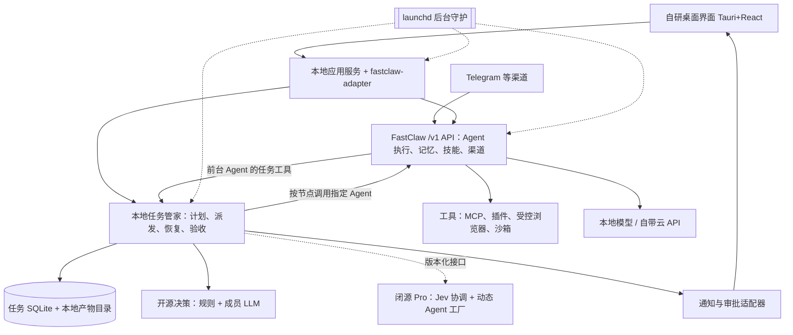

# Architecture / 架构（依据方案第 4、5 节）

> 拟议设计，尚未实现或实测。

## 1. 路线选择
| 路线 | 收益 | 局限 | 采用 |
|---|---|---|---|
| 只复用 FastClaw 原生群聊 | 最快获得串并行和失败替补 | 不能承诺重启后续跑未完成工具调用和交付物验收 | 早期演示、普通群聊 |
| **FastClaw 运行时 + 本地任务管家** | 保留上游能力，有任务记录、恢复和验收 | 需开发小型本地服务和适配层 | **主线** |
| 重写 Agent 内核和模型网关 | 完全控制 | 范围过大 | 不采用 |

## 2. 总体结构

应用服务、任务管家、决策接口、通知适配器首版可在同一本地进程，是职责划分而非微服务。Pro 按需加载，只通过 `packages/shared-types/src/pro-interface.ts` 提交决策建议和受限成员创建请求，不另起调度状态、不绕过审批。

## 3. 关键模块
### 3.1 FastClaw（执行底座）
- 复用 Agent 运行、模型提供方、会话、长期记忆、知识库、技能、MCP、沙箱、渠道、定时触发。
- 群聊重启只保留已完成记录，不恢复未完成工具调用：“有群聊协作”与“长任务可恢复”分别验收。
- 任务模式下任务管家是唯一派单者；原生 coordinator 与 Worker 递归委派不得同时派单。
- 三个权限档：普通聊天（已授权工具）/ 任务前台（只能提交、查询、取消任务）/ Worker（只执行被分配节点，禁止递归建任务）。

### 3.2 本地任务管家（`services/task-manager`）
保存目标/交付物/预算/授权 → 校验 Leader 计划 → 派发节点（限并行、记尝试）→ 检测超时阻塞、重试或替补 → 保存产物、外部作业、审批、回执 → 验收决定完成/返工/等待用户/停止。常驻 TypeScript 服务；关闭窗口不终止任务。单实例，SQLite 事务领取节点。

### 3.3 模型与决策
FastClaw 自带提供方；阶段 0 一云一本地。本地模型只承诺基础对话。决策路径：程序过滤 → 规则/LLM 选择 → 程序校验 → 执行。Community 无 Jev、无动态创建入口。纯本地模式禁止一切云调用。

### 3.4 最小可行协作
研究员 + 整理员（Leader 为角色）。状态：待执行 → 执行中 → 待验收 → 已完成；另有等待用户、重试等待、需核查、失败、取消。全局 Worker 槽初始 2。Agent 说“完成”只进入待验收。

### 3.5 可靠性与恢复
心跳≠进展；拿不到可靠状态时显示“状态未知”。替补接管前确认旧执行停止或已失效。只承诺从检查点恢复；外部动作先记意图与批准，再执行记回执，可用时用幂等键，超时≠未执行，无法核实进入需核查。

### 3.6 审批、权限、沙箱
审批绑定任务、节点、接收方、内容摘要和有效期；内容变化重新确认。不依赖提示词“请先确认”。沙箱默认强制 `FASTCLAW_SANDBOX_ENFORCE=1`（OrbStack/Docker），MCP/浏览器/渠道逐项验证。密钥来自钥匙串或环境变量，不进前端、提示词、Worker 沙箱、日志、导出。

### 3.7 存储与后台
FastClaw 管自己的库，本项目不直接改。任务管家独立 SQLite：tasks、nodes、attempts、events、artifacts、approvals、external_jobs、receipts、notifications、memory_facts(+FTS5)、memory_access（见 `services/task-manager/src/schema.ts`）。产物按任务/尝试分目录并记校验值。首版不引入 Redis/Postgres/向量库。例行任务按用户时区，单一计时者。

### 3.8 长期共享记忆（Community 必须交付）
SQLite + 全文检索；按权限读、检索、提交、修正、删除；用户明确偏好优先；推测先为候选；冲突保留修正链；删除同步清索引。

### 3.9 开源 / 闭源边界
- 开源：界面、FastClaw 适配、固定成员调度、共享记忆、任务记录、基础恢复、审批、导入导出。
- 闭源（`opengrok-pro`）：动态 Agent 工厂、Jev 协调、商业授权模块。
- 接口：决策建议、受限成员创建请求、运行事件、产物引用（`PRO_INTERFACE_VERSION`，semver）。
- **Community 不依赖 Pro**（`scripts/check-boundaries.mjs` 强制）。
